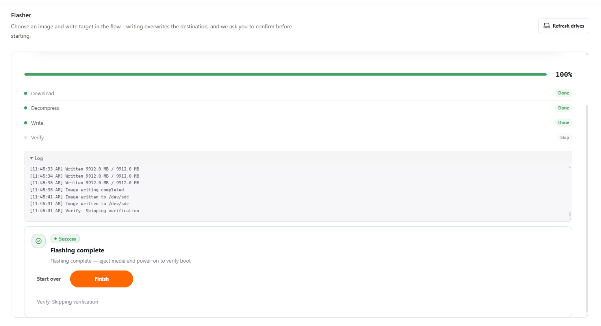
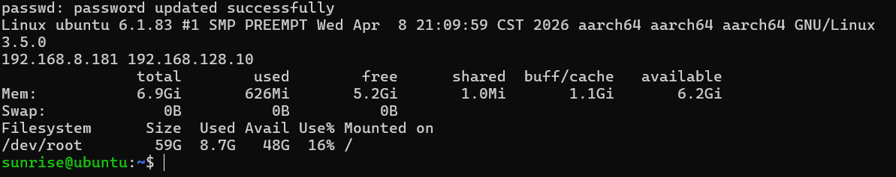
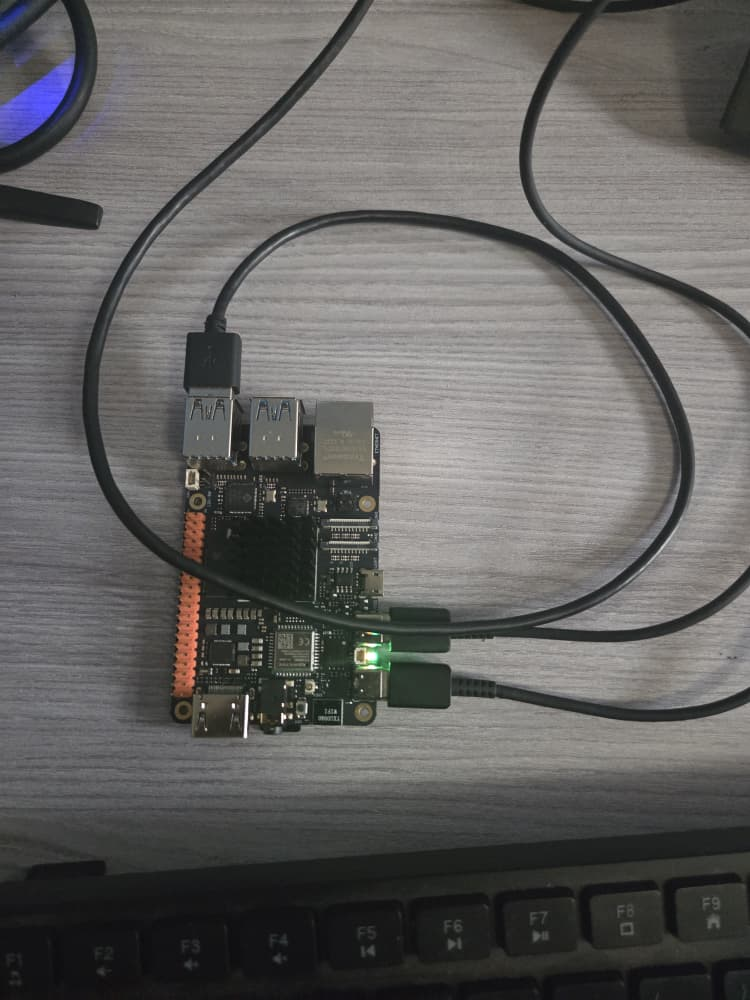
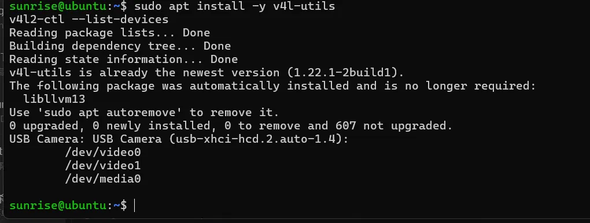
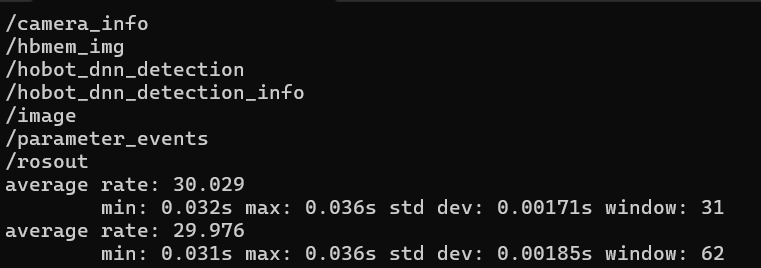

# RDK X5 Autonomous Drone

My project for the **Robotics Dream Keeper Challenge — 2026 Winter** by D-Robotics.

## Project Goal

Build an **autonomous drone** that uses **onboard AI and vision** on the **D-Robotics RDK X5** to navigate and fly safely in complex environments such as **hilly terrain**, supporting **agriculture**, **mapping**, and **emergency response**.

All perception and decision-making run on the drone itself, using the RDK X5's **BPU** for accelerated AI inference, so the drone can operate where connectivity is limited.

## Hardware

| Item | Details |
|---|---|
| Compute | D-Robotics RDK X5 (8 GB RAM) |
| Storage | 64 GB microSD card |
| Camera | HBVCAM-W20217 V22, USB (UVC) |
| IMU | _TODO_ |
| Power | _TODO: adapter used (5V/5A recommended)_ |

## Stage 1 — Ignite

### 1. Board Bring-Up

**System image:** RDKOS 3.5.0 Desktop

**Flashing (in-board, no SD card reader):**
1. Insert the microSD card into the board's slot (underside).
2. Connect the board's upper USB-C port (**USB2**, Flash Connect) to the PC.
3. Hold the **KEY** button, connect power to the lower USB-C port, wait ~5 s, release.
4. The SD card appears as **Linux UMS disk 0**. Flash the RDK X5 Ubuntu 22.04 desktop image with **RDK Studio**.
5. Power-cycle without holding KEY. Boot is complete when the green LED is solid and the orange/red LED blinks.

**Connecting:**
- Over USB-C (Flash Connect): `ssh sunrise@192.168.128.10`
- Over Wi-Fi (configured in RDK Studio's connect wizard): `ssh sunrise@<board-wifi-ip>`

**Evidence commands:**
```bash
uname -a
cat /etc/version
hostname -I
free -h && df -h /
```




### 2. Sensor Explorer — USB Camera

**Sensor:** HBVCAM-W20217 V22 USB camera (detected as `/dev/video0`, MJPG, up to 1280×720 @ 30 fps)
**Interface:** USB (UVC) + ROS 2 node (TogetheROS.Bot, Humble)

Plug the camera into one of the board's blue USB 3.0 ports, then check that it is detected and list its supported formats:

```bash
sudo apt install -y v4l-utils
v4l2-ctl --list-devices
v4l2-ctl -d /dev/video0 --list-formats-ext   # use the /dev/video* shown above
```

With the camera node running (started by the launch command in step 3), confirm it publishes frames:

```bash
source /opt/tros/humble/setup.bash
ros2 topic list
ros2 topic hz /image
```

**Result:** the camera publishes `/image` at a steady **~30 Hz** (std dev ≈ 2 ms), matching the camera's 30 fps spec. It supports MJPG at up to 1280×720; 640×480 was used for the demo.





### 3. First AI Task — YOLO Object Detection on the BPU

Runs the pre-trained YOLOv5 model (COCO, 80 classes) on the BPU using the USB camera feed (640×480):

```bash
source /opt/tros/humble/setup.bash
export CAM_TYPE=usb
ros2 launch dnn_node_example dnn_node_example.launch.py \
  dnn_example_config_file:=config/yolov5workconfig.json \
  dnn_example_image_width:=640 dnn_example_image_height:=480
```

View the live detections in a browser on the PC at `http://<board-ip>:8000`. The model correctly detected a person and a bottle in real time.


Demo video: 

https://github.com/user-attachments/assets/206f594d-c7a0-4acc-b9b2-ef0c5b23fccf


## Dependencies

- RDK X5 Ubuntu 22.04 image with TogetheROS.Bot (ROS 2 Humble), preinstalled
- RDK Studio (PC) for flashing and connecting
- `v4l-utils` for checking the USB camera: `sudo apt install -y v4l-utils`

## Troubleshooting

| Problem | Cause / Fix |
|---|---|
| A 10 MB "Linux File-Stor Gadget" drive appears in the flasher | That's the **running** board's virtual drive, not the SD card. Power off, hold **KEY**, power on → the card appears as "Linux UMS disk 0". |
| Windows shows a 254 MB "CONFIG" drive | Only the small boot partition is visible to Windows; the flasher still writes the whole card. Never format it. |
| `timedatectl set-ntp true` fails with "NTP not supported" | The image has no NTP service. Set the clock from the internet: `sudo date -s "$(wget -qSO- --max-redirect=0 google.com 2>&1 \| grep Date: \| cut -d' ' -f5-8)Z"` |
| _TODO: add problems as you hit them_ | |

## License & Credits

- Code in this repository: MIT License
- Stock YOLO models and examples: D-Robotics TogetheROS.Bot
